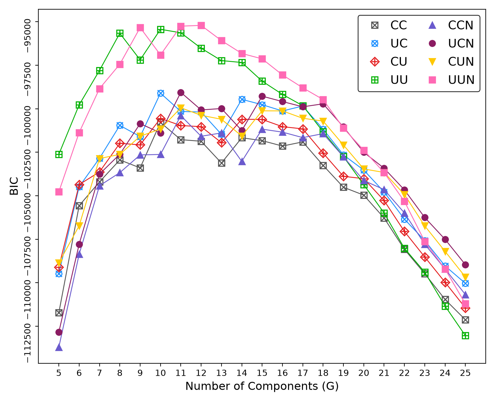

# edm — MEDseq exponential-distance mixtures in PyTorch

A PyTorch reimplementation of the **MEDseq** model family from

> Murphy, K., Murphy, T. B., Piccarreta, R. & Gormley, I. C. (2021).
> *Clustering longitudinal life-course sequences using mixtures of exponential-distance models.*
> Journal of the Royal Statistical Society: Series A, 184(4), 1414–1451.
> [doi:10.1111/rssa.12712](https://doi.org/10.1111/rssa.12712)

The paper fits its models with an ECM algorithm. This project fits all eight MEDseq variants by gradient descent instead, using autodiff and Adam. To make the discrete central sequences differentiable, each one is relaxed to a *soft*, temperature-controlled one-hot sequence. The included `main.py` reproduces the paper's Figure 3 on the MVAD school-to-work data.



---

## Features

- **All eight model types** (`CC`, `UC`, `CU`, `UU`, `CCN`, `UCN`, `CUN`, `UUN`). Each is an `nn.Module` in its own file, and all are selectable through one `EDModel` class driven by the `EDMType` enum.
- **Soft central sequences.** Each θ is a `softmax(φ / τ)` over states, and the temperature τ is annealed during training. A straight-through option is also available.
- **Survey sampling weights**, applied as a weighted pseudo-likelihood. Weights are normalised to sum to *n*.
- **Gating covariates** through a multinomial-logit gating network, with both the gated-noise (GN) and non-gated-noise (NGN) settings.
- **Uniform noise component** for deviant trajectories.
- **Model selection by BIC**, with parameter counts that follow the paper's Table A1.
- **Data-driven initialisation.** Fitting starts from weighted k-modes and the closed-form precisions of Appendix B, and runs several restarts.
- **Duplicate collapsing.** Identical (sequence, covariate) rows are merged with their weights summed. This makes fitting faster without changing the likelihood.

---

## Installation

```bash
pip install torch pandas matplotlib
```

Python 3.9 or newer is required. For GPU training, install the CUDA build of PyTorch using the command from [pytorch.org](https://pytorch.org/get-started/locally/), then pass `--device cuda`.

---

## Data

`main.py` expects `mvad.csv`, the MVAD data from the R packages **TraMineR** and **MEDseq**. It has 712 Northern Irish youths observed monthly from July 1993 to June 1999. To export it from R:

```r
data(mvad, package = "TraMineR")
write.csv(mvad, "mvad.csv", row.names = FALSE)
```

The loader uses:

| What | Columns |
|---|---|
| Sequences | `Sep.93` … `Jun.99`. July and August 1993 are dropped as in the paper, so **T = 70**. |
| States | `employment`, `FE`, `HE`, `joblessness`, `school`, `training`, coded as EM, FE, HE, JL, SC, TR |
| Sampling weights | `weight` |
| Gating covariates | `catholic`, `fmpr`, `funemp`, `gcse5eq`, `male` (Gender), `livboth` (yes/no) |

`Grammar` and the five `Location` columns are not used as covariates, because the sampling weights are built from them (paper, Section 2).

---

## Quick start

```bash
# Fit all 8 types for G = 1..25 with all covariates, then plot Figure 3
python main.py

# A quicker run
python main.py --g-max 15 --n-init 2

# Only the model types and covariate selected in the paper
python main.py --types UUN --covariates GCSE5eq

# Re-plot a saved table without refitting
python main.py --plot-only results/bic_table.csv --show
```

A full run fits roughly 190 (type, G) combinations, each with several restarts. The BIC table is saved after every fit, so you can stop early and re-plot what has finished.

### Outputs

| File | Contents |
|---|---|
| `results/bic_table.csv` | One row per fit: `type`, `G`, `covariates`, `bic`, `loglik`, `n_params` |
| `results/figure3_bic.png` | BIC against G for every model type, in the style of the paper's Figure 3 |
| console | Best model by BIC: central sequences as state-permanence labels such as `(SC,25)-(HE,45)`, MAP cluster sizes, and gating coefficients |

### Command-line options

| Option | Default | Description |
|---|---|---|
| `--csv` | `mvad.csv` | Path to the data |
| `--out` | `results` | Output directory |
| `--types` | `all` | Comma-separated model types, e.g. `UUN,CCN` |
| `--g-min`, `--g-max` | `1`, `25` | Range of components to fit |
| `--plot-g-min` | `5` | Smallest G shown in the plot (Figure 3 hides G < 5) |
| `--covariates` | `all` | `all`, `none`, or names such as `GCSE5eq,Gender` |
| `--no-weights` | off | Ignore the sampling weights |
| `--gated-noise` | off | Use the GN gate instead of NGN |
| `--normalizer` | `hamming` | `hamming`, `exact` or `sampled` (see [Normaliser options](#how-the-gradient-descent-version-works)) |
| `--mc-samples` | `32` | Sequences drawn per component per step with `--normalizer sampled` |
| `--n-init` | `3` | Random restarts per fit |
| `--epochs` | `600` | Training epochs per restart |
| `--lr` | `0.05` | Adam learning rate |
| `--seed` | `0` | Base random seed |
| `--device` | `cpu` | `cpu` or `cuda` |
| `--plot-only TABLE` | — | Skip fitting and plot a saved table |
| `--show` | off | Also open the figure in a window |

---

## Python API

```python
import torch
from edm import EDModel, EDMType, select_by_bic

# S: (n, T) integer states in [0, v); w: (n,) sampling weights; x: (n, r) numeric covariates
model = EDModel(EDMType.UUN, n_components=11, seq_len=70, n_states=6, n_covariates=1)
model.fit(S, weights=w, covariates=x, n_init=3, epochs=600)

model.bic()                    # 2ℓ − k·log n (larger is better)
model.predict(S, x)            # MAP labels; the noise component is the last index
model.predict_proba(S, x)      # responsibilities ẑ
model.central_sequences()      # (K, T) hard central sequences
model.precision()              # (K, T) precision parameters λ
model.gating_coefficients()    # intercept + slopes, relative to component 0

# Fit a grid of types and G values and keep the best by BIC
best, table = select_by_bic(S, n_states=6, n_components=range(2, 15), weights=w, covariates=x)
```

`EDModel` also accepts these model options as keyword arguments: `gated_noise`, `normalizer` (`"hamming"`, `"exact"` or `"sampled"`), `mc_samples`, `straight_through` and `init_precision`.

`model.sample_components(n)` draws `n` sequences from each fitted non-noise component and returns a tensor of shape `(K, n, T)`.

`fit` also accepts these training options: `temperature=(start, end)`, `anneal_frac`, `batch_size`, `tol`, `patience`, `noise_init`, `collapse`, `seed`, `device`, `dtype` and `verbose`.

For a custom training loop, call `model(X, covariates)` on one-hot input `X` of shape `(n, T, v)`. It returns per-sequence log-likelihoods.

---

## The model family

Each non-noise component *g* has a central sequence θ_g and precisions λ_{g,t} ≥ 0:

$$
\log f_g(\mathbf{s}) = -\sum_{t=1}^{T} \lambda_{g,t}\,\mathbb{1}(s_t \neq \theta_{g,t}) \;-\; \sum_{t=1}^{T} \log\!\big((v-1)e^{-\lambda_{g,t}} + 1\big)
$$

This is an exponential-distance model built on a weighted Hamming distance. Its normalising constant has a closed form. The model types differ only in how λ is shared:

| Type | λ across clusters | λ across time | Noise component | Precision parameters |
|---|---|---|---|---|
| `CC`  | shared | shared | – | 1 |
| `UC`  | per cluster | shared | – | K |
| `CU`  | shared | per time point | – | T |
| `UU`  | per cluster | per time point | – | K·T |
| `CCN` | shared | shared | ✓ | 1 |
| `UCN` | per cluster | shared | ✓ | K |
| `CUN` | shared | per time point | ✓ | T |
| `UUN` | per cluster | per time point | ✓ | K·T |

Here K is the number of non-noise components: K = G for the first four types and G − 1 for the noise types. The noise component has λ = 0, so it is uniform with f₀(s) = v⁻ᵀ.

### How the gradient-descent version works

- **Soft θ.**
  - Each central sequence is stored as logits φ_g ∈ ℝ^{T×v}, with θ̃_{g,t} = softmax(φ_{g,t}/τ).
  - The mismatch indicator becomes 1 − ⟨x_t, θ̃_{g,t}⟩, where x_t is the one-hot observed state.
  - States never observed at time *t* are masked out.
  - τ is annealed geometrically during the first part of training and then held fixed.
- **Normaliser options.**
  - `"hamming"` (default) keeps the paper's constant. For soft θ̃, the objective is then a lower bound on the log-likelihood of a proper distribution, and the bound is exact when θ̃ is one-hot. For fixed responsibilities and λ the objective is linear in θ̃, so its maximiser is the weighted modal sequence, exactly the paper's CM-step for θ.
  - `"exact"` uses the exact normaliser for soft θ̃, ∏_t Σ_k exp(−λ_{g,t}(1 − θ̃_{g,t,k})).
  - `"sampled"` keeps the value of the `"exact"` normaliser but does not differentiate its closed form. Instead it estimates the gradient by Monte Carlo, using equation 18.13 of Goodfellow, Bengio & Courville, *[Deep Learning](https://www.deeplearningbook.org/contents/partition.html)*: ∇ log Z_g = E_{s∼f_g}[∇ log f̃_g(s)], where log f̃_g is the unnormalised log-density.
    - Every training step draws `mc_samples` sequences from each component (the "negative phase") and averages ∇ log f̃_g over them.
    - Each component is a product of independent categoricals over time, so the samples are exact and no Markov chain is needed.
    - The estimate is unbiased for the `"exact"` gradient.
    - The forward value stays exact, because the responsibilities, the loss and early stopping all need log Z_g itself.
- **Precisions** are parameterised as λ = softplus(ρ) ≥ 0.
- **Objective.** Adam maximises the weighted pseudo log-likelihood (1/n) Σᵢ wᵢ log f(sᵢ).
- **Reporting.** Final log-likelihoods and BIC are computed with hard central sequences θ = argmax φ, where all three normalisers coincide.
- **Gating.**
  - The mixing proportions follow a multinomial logit in the covariates, with component 0 as the reference.
  - Under NGN, the noise probability τ₀ is constant and the covariates only affect the non-noise components.
- **Initialisation.**
  - Weighted k-modes under the Hamming distance (a CEM-fitted CC model with λ = 1) provides hard starting clusters.
  - From these, central sequences, closed-form precisions and mixing proportions are set.
  - The restart with the highest log-likelihood is kept.

---

## Project structure

```
edm/
├── __init__.py   # public exports
├── types.py      # EDMType enum
├── utils.py      # one-hot encoding, weights, duplicate collapsing, k-modes, closed-form λ
├── gating.py     # GatingNetwork (no covariates / GN / NGN)
├── base.py       # BaseEDM: soft θ, likelihood, posterior, BIC counts, initialisation
├── cc.py  uc.py  cu.py  uu.py     # precision structure of each model type
├── ccn.py ucn.py cun.py uun.py    # the same with a uniform noise component
└── model.py      # EDModel (fit / predict / bic) and select_by_bic
tests/
└── test_sampled_normalizer.py   # Monte Carlo log Z gradient (normalizer="sampled")
main.py           # MVAD loading, model fitting, Figure 3
```

### Tests

The tests use only the standard library's `unittest` and take about a second. Run them from the repository root:

```bash
python -m unittest discover tests
```

`pytest tests` also works if you have pytest installed.

---

## Differences from the paper

- **Optimisation.** The paper uses exact ECM with a k-medoids start. Here the fit is gradient descent with temperature annealing and a k-modes start. Expect the same overall picture: the paper's optimum is a UUN model with G = 11. Exact BIC values can differ because the optimiser may reach different local optima.
- **Not included.**
  - The greedy stepwise covariate search (paper Tables 2–3).
  - Weighted-likelihood-bootstrap standard errors for the gating coefficients.
  - Seriation of clusters. Cluster order is arbitrary, so the gating reference cluster is whichever cluster comes first.
- **Tips.** If restarts disagree, increase `--n-init` or `--epochs`, anneal more slowly with a larger `anneal_frac`, or lower `--lr`.

---

## References

- Murphy, K., Murphy, T. B., Piccarreta, R. & Gormley, I. C. (2021). Clustering longitudinal life-course sequences using mixtures of exponential-distance models. *JRSS-A*, 184(4), 1414–1451.
- McVicar, D. & Anyadike-Danes, M. (2002). Predicting successful and unsuccessful transitions from school to work by using sequence methods. *JRSS-A*, 165(2), 317–334.
- Murphy, K., Murphy, T. B., Piccarreta, R. & Gormley, I. C. *MEDseq: mixtures of exponential-distance models with covariates* (R package).
- Gabadinho, A., Ritschard, G., Müller, N. S. & Studer, M. (2011). Analyzing and visualizing state sequences in R with TraMineR. *Journal of Statistical Software*, 40(4), 1–37.

```bibtex
@article{murphy2021medseq,
  title   = {Clustering longitudinal life-course sequences using mixtures of exponential-distance models},
  author  = {Murphy, Keefe and Murphy, T. Brendan and Piccarreta, Raffaella and Gormley, I. Claire},
  journal = {Journal of the Royal Statistical Society: Series A (Statistics in Society)},
  volume  = {184},
  number  = {4},
  pages   = {1414--1451},
  year    = {2021},
  doi     = {10.1111/rssa.12712}
}
```
